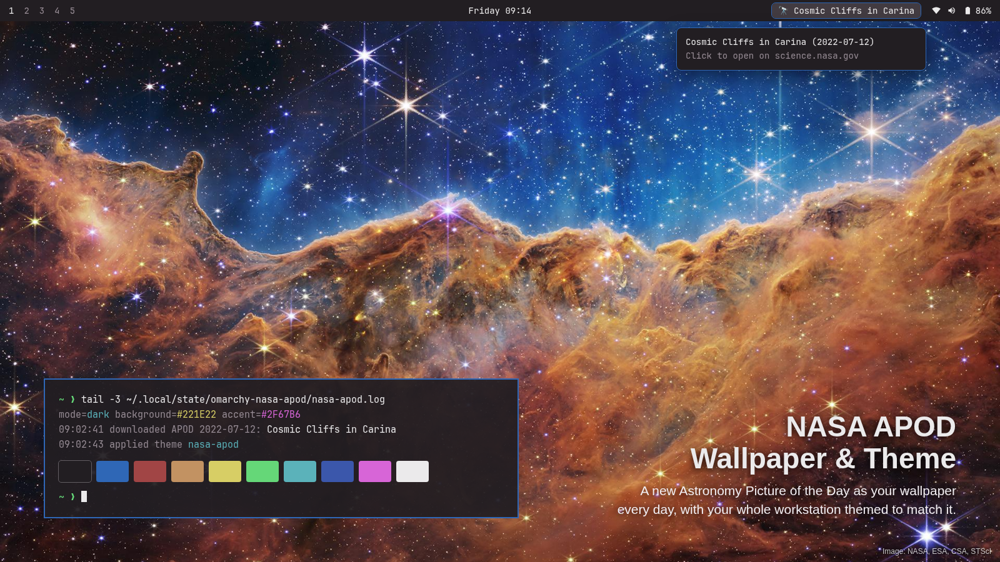

# NASA APOD Wallpaper & Theme for Omarchy

An [Omarchy](https://omarchy.org) shell plugin that sets NASA's
[Astronomy Picture of the Day](https://science.nasa.gov/apod/) as your
wallpaper every day and themes your workstation to match it.

- Downloads the full-resolution picture each day and makes it your wallpaper.
- Generates a matching color palette from it and installs it as the
  `nasa-apod` Omarchy theme, so your terminal, bar, window borders and other
  themed apps pick up the picture's colors.
- Shows today's title in the bar. Hover for the date, click to open the
  picture's page and explanation on science.nasa.gov, right-click to use it
  as your theme.



No API key needed.

This is a community project. It is not affiliated with or endorsed by NASA.

## Install

```bash
omarchy plugin add https://github.com/hoowot/omarchy-nasa-apod-theme.git --enable
```

Installing doesn't change your theme. Within a few seconds of the widget
loading, 🔭 and today's title appear in the bar, the plugin builds a
`nasa-apod` theme from today's picture, and you get a one-time notification
that it's ready.

### Start using it

Do any one of these:

- **Right-click 🔭** in the bar.
- **Click the "NASA APOD theme is ready" notification.**
- **Pick "Nasa Apod"** in the theme switcher (`omarchy theme switcher`).

That switches your wallpaper, and your terminal, bar, window borders and
other themed apps, to today's picture. From then on it updates by itself
every day. To stop, pick any other theme; the plugin won't switch you back.
Your other themes are never changed.

If you'd rather the plugin switch to it on its own, including right after
install, turn on [`switchTheme`](#settings).

The widget checks once an hour, but only contacts NASA when the next day's
picture is due. APOD usually posts just after midnight US Eastern time.

### Updating

```bash
omarchy plugin update hoowot.nasa-apod-theme
omarchy restart shell
```

The bar keeps running the old version of the widget until the shell
restarts (or you log out and back in).

### Requirements

Everything ships with a standard Omarchy install: `curl`, `jq`, `python3`
(3.9 or newer), ImageMagick (`magick`) and `flock` (util-linux).

## Settings

Open the bar widget's settings in Omarchy, or set them on the widget's entry
in `~/.config/omarchy/shell.json`:

| Setting       | Default | What it does |
|---------------|---------|--------------|
| `switchTheme` | `false` | When `false`, the plugin keeps the `nasa-apod` theme up to date but never switches to it on its own; it only re-applies it each day if it's already your current theme. When `true`, it switches to the `nasa-apod` theme as soon as the widget loads, including right after install, and again whenever a new picture arrives, even if you've picked another theme. |
| `showTitle`   | `true`  | Show today's title next to the 🔭 icon. When `false`, only the icon shows and the title stays in the tooltip. |

## How it works

The bar widget runs `bin/nasa-apod-theme` on load and then hourly. The
script:

1. If it has already handled today's picture (by US Eastern date), it stops
   without any network request. Otherwise it reads the APOD RSS feed at
   `https://science.nasa.gov/feed/apod-basic/` and takes the newest item.
2. Checks the item: the image must be on NASA's asset server and the link on
   science.nasa.gov, and the title is cleaned of control characters. It then
   downloads the original image, checks that it really is a JPEG, PNG or
   WebP, and re-encodes it as a JPEG (at most 8K) with metadata removed.
   On days when APOD is an embedded video
   (YouTube or Vimeo), the wallpaper stays as it is, because the only
   picture NASA publishes for those is a screenshot of the video player. The
   bar still shows the title, and clicking it opens the video. Days with a
   native video use the still frame NASA publishes, which is a clean image.
3. Runs `bin/apod-palette.py`, which quantizes the image with ImageMagick and
   writes `colors.toml`. The background comes from the most common color, the
   accent from the most saturated color that contrasts with it, and the
   terminal colors from the image's hues where it has them.
4. Writes the theme to `~/.config/omarchy/themes/nasa-apod/`. If
   `nasa-apod` is already your current theme, it runs
   `omarchy theme set nasa-apod` to show the new picture. Otherwise it
   leaves your theme alone, and the first time sends the one notification
   described in [Start using it](#start-using-it). With `switchTheme` on, it
   runs `omarchy theme set nasa-apod` every time, switching your theme.
5. Records the date, title and link in the state file, which the widget
   watches.

Each monitor gets its own copy of the widget. A lock file makes sure only one
copy runs the script at a time.

You can also run it by hand:

```bash
~/.config/omarchy/plugins/hoowot.nasa-apod-theme/bin/nasa-apod-theme            # refresh and switch
~/.config/omarchy/plugins/hoowot.nasa-apod-theme/bin/nasa-apod-theme --force    # redo today's picture
~/.config/omarchy/plugins/hoowot.nasa-apod-theme/bin/nasa-apod-theme --switch if-active
```

### Why not the APOD API?

Earlier versions used `api.nasa.gov/planetary/apod`. Since APOD moved to
science.nasa.gov in 2026, that endpoint mostly returns HTTP 500. On the days
it does respond, it returns a placeholder titled "NASA Science" that points
at a small NASA logo, so the wallpaper stopped changing. The RSS feed is what
the new site publishes. As a safeguard, the script also refuses any image
under 50 KB, so a placeholder can't replace your wallpaper.

## Files

| Path | Contents |
|------|----------|
| `~/.config/omarchy/plugins/hoowot.nasa-apod-theme/` | The plugin |
| `~/.config/omarchy/themes/nasa-apod/` | The generated theme: `colors.toml` and `backgrounds/apod-<date>.jpg` (only today's picture is kept; other files you put there are left alone) |
| `~/.local/state/omarchy-nasa-apod/state.json` | Today's date, title and link |
| `~/.local/state/omarchy-nasa-apod/nasa-apod.log` | What each run did. Start here if something looks wrong. |

`XDG_CONFIG_HOME` and `XDG_STATE_HOME` are respected if you set them.

## Troubleshooting

- **The wallpaper isn't changing.** Check the log:
  `tail ~/.local/state/omarchy-nasa-apod/nasa-apod.log`
- **"fetch failed" or "could not parse APOD feed".** science.nasa.gov is
  down, or its feed has changed. Open the feed URL above in a browser to
  check.
- **"image URL is not on assets.science.nasa.gov" (just above "could not
  parse APOD feed"), or "downloaded file is not a JPEG, PNG or WebP
  image".** The feed pointed somewhere the plugin doesn't trust, so it
  kept your current wallpaper. If this keeps happening, NASA has probably
  changed where it hosts images and the plugin needs an update.
- **"missing dependency".** The log names the missing command. Run
  `omarchy pkg install` and pick the package that provides it: `curl`,
  `jq`, `python`, `imagemagick` (for `magick`), or `util-linux` (for
  `flock`). `omarchy` itself comes with Omarchy.
- **Right-click does nothing.** Either `nasa-apod` is already your current
  theme, or the first picture hasn't been built yet (for example, if you
  installed on a day when APOD is a video). Hover over 🔭: the tooltip shows
  "Right-click to use it as your theme" when it's available.
- **I switched themes and it switched me back.** That's `switchTheme: true`.
  Turn it off to keep the theme you picked.

## Uninstall

```bash
omarchy plugin remove hoowot.nasa-apod-theme
rm -rf ~/.config/omarchy/themes/nasa-apod ~/.local/state/omarchy-nasa-apod
```

Switch to another theme first if `nasa-apod` is your current one.

## Privacy and security

- The only network requests are HTTPS downloads of the APOD feed and the
  day's image from science.nasa.gov. Nothing about you or your system is
  sent, though, like any web request, they reveal your IP address.
- This is a personal hobby project with no commitment to respond to
  reports, fix issues, or keep it maintained. It is provided "as is",
  without warranty of any kind. See [`LICENSE`](LICENSE).
- Found a security problem? Please report it privately. See
  [`SECURITY.md`](SECURITY.md).

## Image credits

APOD pictures belong to the people credited on each day's page, and many
are copyrighted. This plugin only downloads today's picture for use on your
own desktop. Don't redistribute the images without checking the credit
line. This project is not affiliated with or endorsed by NASA.

The picture in `preview.png` is the James Webb Space Telescope's "Cosmic
Cliffs" in the Carina Nebula, credited to NASA, ESA, CSA and STScI, from
the [NASA Image and Video Library](https://images.nasa.gov/details/carina_nebula).
It is used under [NASA's media usage guidelines](https://www.nasa.gov/nasa-brand-center/images-and-media/).
The bar, tooltip and terminal in the preview are a mockup drawn in the colors
the plugin generates from that picture.

## License

[MIT](LICENSE)

## Contributing

See [`CONTRIBUTING.md`](CONTRIBUTING.md). Please read it before opening a
pull request, especially the sections on keeping personal information out
of commits and screenshots.
